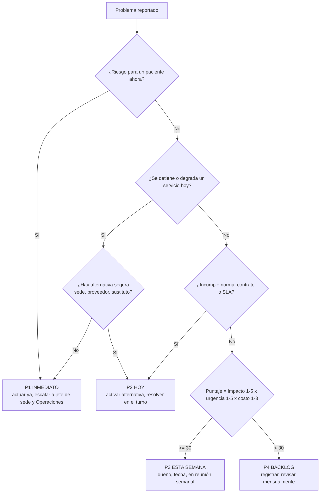

# Plantillas y flujograma de priorización

## Flujograma de priorización de problemas operativos



Salida obligatoria: nivel, dueño, próxima acción, fecha. Un P1 abierto se reporta en el huddle hasta cerrarse.

## SOP (procedimiento operativo estándar)

```
SOP-<área>-<nnn> · <Título> · v<x.y> · Vigente desde AAAA-MM-DD · Dueño: <rol> · Revisión: cada 12 meses
1. Objetivo
2. Alcance (sedes, servicios, a quién aplica)
3. Definiciones
4. Responsables (rol → responsabilidad)
5. Insumos y sistemas (HIS, Odoo, escáner, formatos)
6. Procedimiento (pasos numerados; quién, qué, con qué, cuándo; puntos de control marcados ⚑)
7. Excepciones y contingencia
8. Registros y evidencia (qué queda, dónde, cuánto tiempo)
9. Indicadores (nombre, fórmula, meta)
10. Referencias (norma, protocolo clínico, contrato)
11. Control de cambios (versión, fecha, qué cambió, quién aprobó)
```

## SIPOC

| Proveedores | Entradas | Proceso (5–7 pasos) | Salidas | Clientes |
|---|---|---|---|---|

Luego: mapa de proceso con tiempos (ciclo, espera), colas y el cuello de botella marcado; desperdicios identificados (esperas, transporte, inventario, movimiento, sobreproceso, defectos, sobreproducción, talento).

## Plan de acción

| # | Acción | Causa que ataca | Dueño | Fecha | Evidencia de cierre | Estado |
|---|---|---|---|---|---|---|

## Matriz de riesgos operativos

| ID | Riesgo (causa → evento → impacto) | Prob. 1–5 | Impacto 1–5 | Puntaje | Dueño | Respuesta | Disparador | Revisión |
|---|---|---|---|---|---|---|---|---|

Impacto en paciente pesa doble: si el evento puede dañar a un paciente, impacto mínimo 4.

## Scorecard de proveedor (mensual)

```
Proveedor · Mes · Comprador
Fill rate ___ % (30) · Puntualidad ___ % (20) · Calidad ___ % (20) · Precio ___ (15) · Servicio ___/5 (15)
Puntaje ___ /100 → Preferente / Observado / Sustituir
Incidencias del mes (fecha, orden, qué pasó, evidencia)
Acuerdos con el proveedor (acción, fecha)
```

## Tablero 4DX

```
Equipo: ______   MCI: "De X a Y para <fecha>"
Lag:  semana 1 ___  2 ___  3 ___  … (línea objetivo)
Lead 1: ______  meta semanal ___  real ___
Lead 2: ______  meta semanal ___  real ___
Compromisos de la semana: (persona · acción · lead que mueve)
```

## Reporte de estado para dirección (una página)

```
Sede / Operaciones · Semana o mes · Fecha
SEMÁFORO general: ● y en una línea por qué
Cómo va: 3 datos clave (ocupación, espera en emergencia, fill rate de críticos…) con tendencia
Cadena de suministro: quiebres, proveedores en alerta, vencimientos
MCI: lag y lead en una línea por equipo
Riesgos activos: 2–3, con respuesta
Incidentes / inspecciones: qué pasó, qué se hizo
Decisiones que se piden a dirección: 1. ___ 2. ___ 3. ___
```

## Plan de dotación por turno

| Servicio | Turno | Pacientes/carga | HCPD | Horas requeridas | Enf. | Aux. | Méd. interno | Técnico | Plantilla actual | Brecha | Costo mensual |
|---|---|---|---|---|---|---|---|---|---|---|---|

## Checklist de apertura de sede

Ver `apertura-sedes.md`; usar como lista con estado (pendiente / en curso / listo / verificado) y responsable por línea.

## Especificación de alerta para el HIS

```
ALERTA-<nnn> · Nombre
Condición (en términos de datos del HIS/Odoo): ______
Umbral / parámetro (y quién lo puede cambiar): ______
Frecuencia de evaluación: tiempo real / cada N min / diaria
Destinatario(s) por rol y canal: ______
Acción esperada y tiempo máximo: ______
Escalamiento si no se atiende: ______
Registro: ______
```
