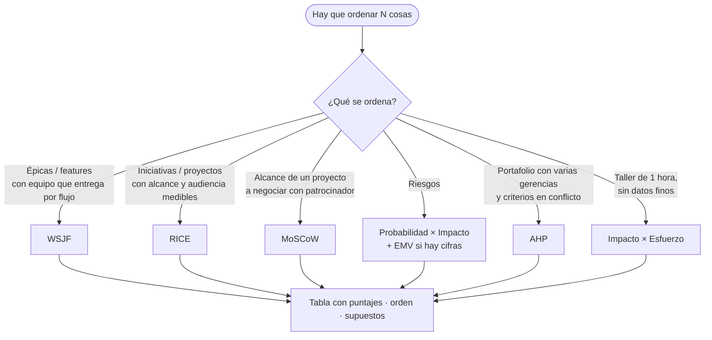

# Algoritmos de priorización

La priorización se hace con un algoritmo declarado, puntajes visibles y supuestos escritos. Así el resultado se discute por los números, no por quién habla más fuerte. `scripts/pm_toolkit.py` calcula WSJF, RICE y AHP desde un CSV.

## Cuál usar

## WSJF — Weighted Shortest Job First (SAFe)

`WSJF = Costo de demora / Tamaño del trabajo`
`Costo de demora = Valor para el negocio/usuario + Criticidad temporal + Reducción de riesgo / habilitación de oportunidad`

Cada factor en escala Fibonacci relativa (1, 2, 3, 5, 8, 13, 20): el más pequeño del conjunto vale 1, los demás se comparan contra él. Tamaño = esfuerzo relativo (puntos o semanas-persona).

Cuándo: backlog de producto o de un ART; cuando lo que duele es *cuánto cuesta cada semana sin esto*. Trampa: inflar "criticidad temporal" porque todo es urgente; exigir la fecha o el evento que la justifica.

Ejemplo (HIS):
| Ítem | Valor | Tiempo | Riesgo/Op | CoD | Tamaño | WSJF |
|---|---|---|---|---|---|---|
| Firma electrónica en consentimientos | 8 | 13 (inspección en 2 meses) | 5 | 26 | 5 | 5.2 |
| Tablero de ocupación en tiempo real | 13 | 3 | 3 | 19 | 8 | 2.4 |
| Rediseño de pantalla de triage | 5 | 2 | 2 | 9 | 3 | 3.0 |

## RICE — Reach, Impact, Confidence, Effort

`RICE = (Alcance × Impacto × Confianza) / Esfuerzo`

- Alcance: personas o transacciones afectadas por período (número real: pacientes/mes, usuarios, facturas).
- Impacto: 3 masivo, 2 alto, 1 medio, 0.5 bajo, 0.25 mínimo.
- Confianza: 100 % con datos, 80 % con estimación sólida, 50 % con intuición.
- Esfuerzo: persona-mes.

Cuándo: comparar iniciativas de distinta naturaleza (una campaña, un módulo, una integración) con un denominador común. Trampa: alcance sin fuente; pedir de dónde sale el número.

## MoSCoW

Must (sin esto el proyecto no sirve o incumple ley), Should (importante, hay alternativa temporal), Could (deseable si sobra), Won't (esta vez no; se escribe para que conste).

Regla de proporción: Must ≤ 60 % del esfuerzo total; si supera, el alcance no es negociable y el proyecto no tiene margen → decirlo. Cuándo: cerrar alcance con un patrocinador; definir el MVP de un go-live.

## Costo de demora (CoD) en dinero

Cuando hay cifras: `CoD semanal = ingreso perdido + costo evitable + multa o riesgo regulatorio ponderado`. Ordenar por `CoD / duración` (es WSJF con dinero). Útil para explicar a Finanzas por qué un proyecto "pequeño" va antes que uno "estratégico".

## AHP — Proceso Analítico Jerárquico (Saaty)

Para portafolio con varias gerencias:
1. Definir criterios (p. ej., impacto en paciente, ingreso, cumplimiento, riesgo técnico, alineación con PETI).
2. Comparar criterios por pares en escala 1–9 (1 igual, 3 moderada, 5 fuerte, 7 muy fuerte, 9 extrema) → matriz → vector de pesos (autovector o media geométrica normalizada).
3. Verificar consistencia: CR < 0.10; si no, revisar los juicios con quien los dio.
4. Puntuar cada proyecto en cada criterio (escala 1–5 o comparación por pares) y calcular puntaje ponderado.

Cuándo: la decisión la deben aceptar siete gerencias con prioridades distintas; el proceso de ponderar criterios *juntos* es tan valioso como el resultado. El script hace la matriz, pesos y CR.

## Probabilidad × Impacto (riesgos)

Escalas 1–5. Puntaje = P × I. Umbrales: ≥ 15 alto (respuesta obligatoria y dueño con fecha), 8–14 medio (respuesta planificada), ≤ 7 bajo (vigilar). Cuando hay cifras, EMV = P(%) × impacto en USD; la suma de EMV de los riesgos aceptados es la **reserva de contingencia** que se pide explícitamente, no un colchón escondido.

## Impacto × Esfuerzo (taller rápido)

Cuatro cuadrantes: hacer ya (alto impacto, bajo esfuerzo), planificar (alto, alto), rellenos (bajo, bajo), evitar (bajo, alto). Sirve para desatascar una reunión; no sustituye a WSJF/RICE cuando hay datos.

## Reglas transversales

- Toda priorización se publica con fecha, algoritmo, puntajes y supuestos; se revisa en cadencia fija (mensual para portafolio, por sprint para backlog).
- Un ítem con restricción legal o de seguridad del paciente con fecha cierta salta la cola; se marca como "forzado" con su justificación, no se maquilla el puntaje.
- Capacidad manda: la lista priorizada se corta donde se acaba la capacidad del período; lo que queda abajo de la línea se comunica como "no en este período", no como "después".
- El PM presenta el orden y los números; la decisión de priorización es de la TTD (backlog) o del comité (portafolio).
