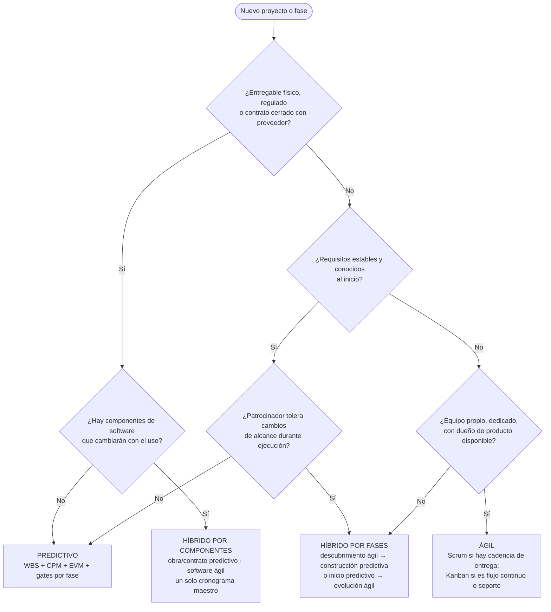
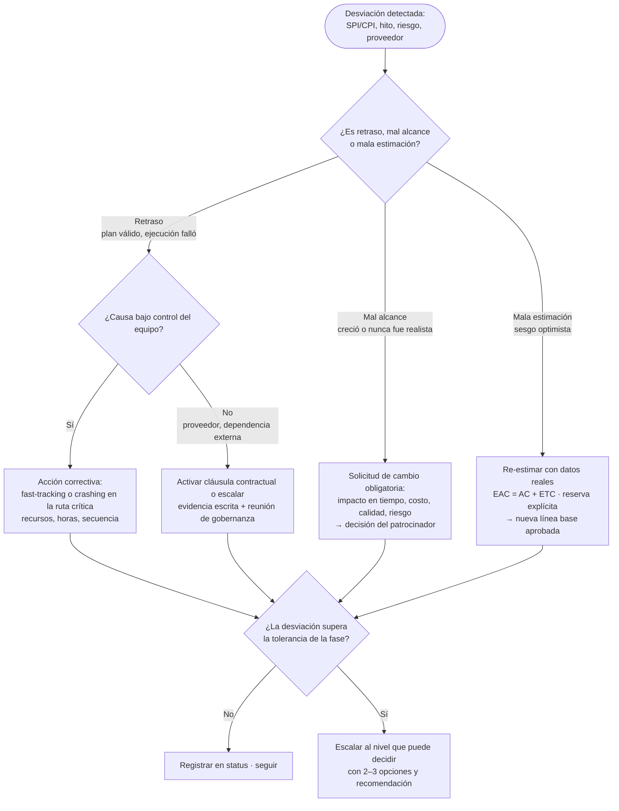

# Flujograma de decisión del PM

Tres flujogramas que el PM recorre **antes** de producir un plan, un cambio o una escalación. Cada uno tiene una versión Mermaid lista para mostrar al usuario cuando pida "cómo decidiste" o "explícame el flujo".

## 1. Elegir el enfoque de gestión

Preguntas en orden; la primera respuesta que decide, decide.

Qué conlleva cada salida (ceremonias mínimas, no máximas):

| Enfoque | Planificación | Control | Ceremonias | Cuándo en Avante |
|---|---|---|---|---|
| Predictivo | WBS completa, cronograma CPM, presupuesto por fase, línea base aprobada | EVM quincenal, control de cambios formal, gate al cierre de cada fase | Kick-off, revisión semanal de avance, gate | Obra y equipamiento de sede nueva; contrato llave en mano con proveedor; migración con fecha regulatoria |
| Ágil (Scrum) | Roadmap por trimestre, backlog priorizado (WSJF/RICE), sprint de 2 semanas | Burn-up, velocidad, revisión de sprint con usuarios | Planning, daily (15 min), review, retro | Evolución de módulos del HIS con equipo propio; desarrollos sobre Odoo |
| Ágil (Kanban) | Backlog con clases de servicio, límites WIP | Lead time, throughput, CFD | Reunión de reposición semanal, revisión de flujo | Soporte, mejoras pequeñas, mesa de integraciones |
| Híbrido por fases | Fase de descubrimiento ágil (4–8 semanas) que produce alcance y estimación; luego línea base predictiva | EVM sobre la línea base + sprints internos | Las de ambos, reducidas | Implantación de HIS en sede nueva; plataforma de integración y MDM |
| Híbrido por componentes | Cronograma maestro predictivo con hitos de integración; cada componente de software con backlog propio | EVM en el maestro, burn-up por componente | Sincronización semanal entre componentes (scrum of scrums) | Sede nueva: obra + red + HIS + Odoo + equipamiento |

Regla de tailoring: cada ceremonia que se agregue debe responder a una pregunta concreta ("¿vamos a llegar?", "¿qué está bloqueado?", "¿aceptamos lo entregado?"). Si no responde ninguna, se quita.

## 2. Qué hacer cuando algo se desvía

Tolerancias por defecto (si el charter no define otras): ±10 % en tiempo y costo por fase, 0 % en alcance comprometido con regulador o paciente, calidad según criterios de aceptación.

## 3. A quién escalar

| Nivel | Decide sobre | Lo que recibe del PM |
|---|---|---|
| Equipo / líder técnico | Secuencia de tareas, asignación diaria, soluciones técnicas dentro del alcance | Tablero, daily, bloqueos |
| PM / PMO | Uso de reserva de contingencia dentro de tolerancia, reasignación de recursos del proyecto, calendario de ceremonias | — |
| TTD (patrocinador técnico) | Arquitectura, prioridad entre proyectos del portafolio, aceptación de gates, cambios dentro de su presupuesto | Gate review, solicitud de cambio con impacto, status con decisión requerida |
| Comité de gerencias / Junta | Cambios de alcance que afectan otra gerencia, presupuesto adicional, fecha regulatoria o de apertura, cancelación | One-pager + opciones con costo y riesgo + recomendación |

Regla: el PM nunca lleva un problema sin opciones ni una opción sin su costo.

## 4. Decidir si un proyecto entra al portafolio (gate 0)

Criterios mínimos para que un pedido se vuelva proyecto (si no cumple, es tarea operativa o se devuelve):
1. Caso de negocio con beneficio medible (ingreso, costo, riesgo evitado, cumplimiento, experiencia del paciente).
2. Patrocinador con nombre y presupuesto identificado.
3. Alcance delimitado en una página (qué entra, qué no).
4. Cabe en la capacidad del trimestre según el algoritmo de priorización vigente (ver `algoritmos-priorizacion.md`); si no cabe, desplaza a otro con justificación o espera.
5. No contradice una decisión de arquitectura registrada (bitácora del Jefe de TI / base de conocimiento de Perkins).

## 5. Go / No-Go de puesta en producción (go-live en salud)

Checklist que el PM exige completo antes de recomendar el go-live de un sistema clínico o administrativo:
- Pruebas de aceptación de usuario firmadas por cada área que opera el sistema.
- Plan de retorno (rollback) probado y con tiempo máximo definido.
- Ventana de cambio fuera de pico asistencial, comunicada a jefaturas clínicas y a la gerencia de Operaciones.
- Soporte reforzado (hypercare) con nombres, turnos y canal durante al menos dos semanas.
- Datos migrados conciliados (conteos y muestra verificada por el dueño del dato).
- Capacitación completada ≥ 90 % del personal que lo usará el primer día.
- Riesgos abiertos de severidad alta: cero sin respuesta.
- Cumplimiento verificado: consentimiento y datos personales (Decretos 143/144), DTE si factura, trazabilidad de accesos.

Si falta uno, la recomendación es **No-Go o Go condicionado** con fecha de verificación; nunca "Go porque ya se anunció".
