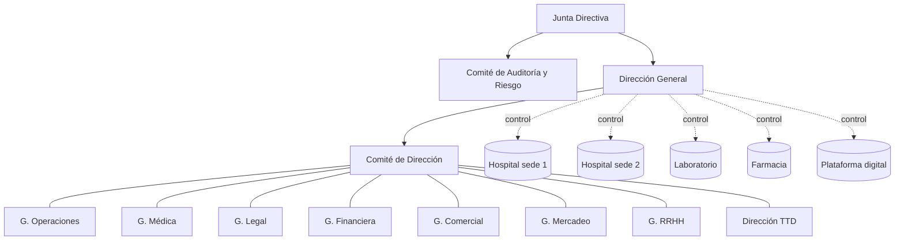
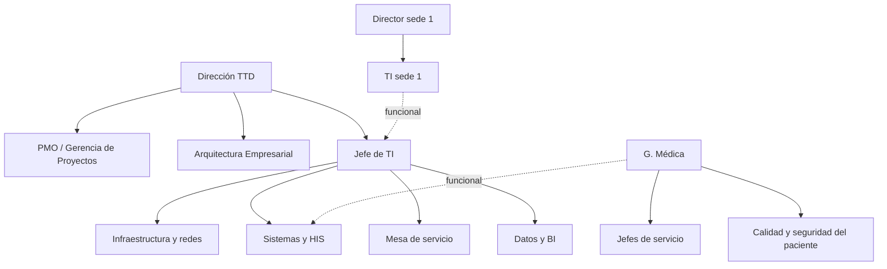
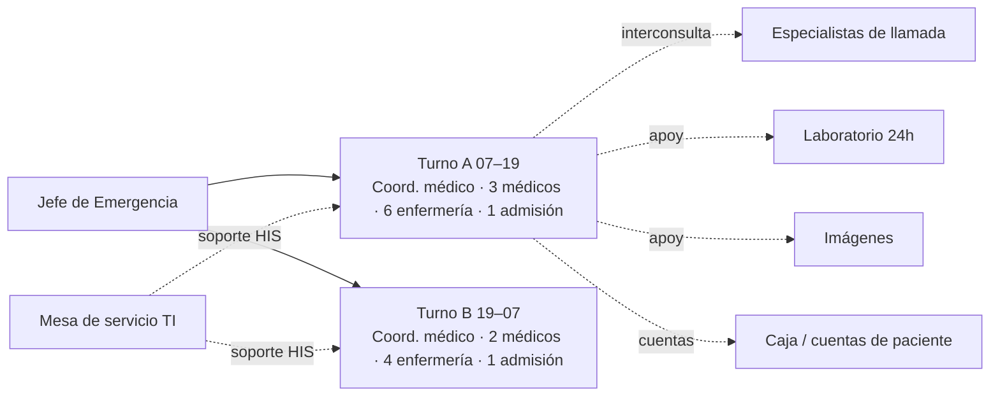
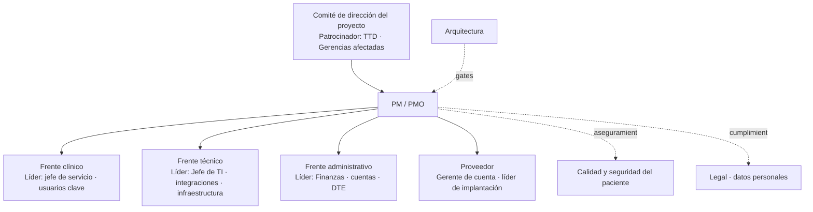

# Organigramas: corporativo, funcional y operativo

Son tres vistas de **la misma organización y las mismas personas**. Cambian la pregunta que responden, no la realidad. Un error frecuente es dibujar uno solo y usarlo para todo: el corporativo no dice quién atiende el turno de noche; el operativo no dice quién firma el contrato.

| Vista | Pregunta que responde | Unidad del diagrama | Líneas | Quién lo usa |
|---|---|---|---|---|
| **Corporativo** | ¿Qué entidades existen y quién gobierna a quién? | Sociedades, junta, comités, gerencias de primer nivel | Propiedad, gobierno, reporte formal | Junta, legal, auditoría, bancos, inversionistas |
| **Funcional** | ¿Qué funciones existen y bajo qué gerencia? | Gerencias, jefaturas, unidades, puestos | Reporte jerárquico (línea sólida) y funcional (punteada) | RRHH, dirección, PMO para RACI y patrocinio |
| **Operativo** | ¿Quién hace qué, dónde y cuándo, para que el servicio funcione? | Sedes, servicios, turnos, equipos de proyecto, roles | Flujo de trabajo, coordinación, cobertura | Operaciones, jefes de servicio, PM del proyecto |

"Diferentes pero iguales": la Gerente Médica aparece en los tres — en el corporativo como miembro del comité de dirección, en el funcional como cabeza de la Gerencia Médica con sus jefaturas, en el operativo como aprobadora del pathway y responsable de la cobertura de jefes de servicio por sede. El PM mantiene una **tabla maestra de posiciones** (ID, puesto, persona, gerencia, sede, reporta a, reporte funcional a) y de ella deriva las tres vistas; así no se contradicen.

## Tabla maestra (fuente única)

```csv
id,puesto,persona,entidad,gerencia,sede,reporta_a,reporte_funcional_a,rol_operativo
P001,Director General,(nombre),Inversiones Avante,Dirección,Corporativo,JUNTA,,Comité de dirección
P010,Gerente Médica,(nombre),Inversiones Avante,Médica,Corporativo,P001,,Aprueba pathways y cobertura clínica
P020,Director TTD,(nombre),Inversiones Avante,TTD,Corporativo,P001,,Arquitectura · prioridad · gates
P021,PM / PMO,(nombre),Inversiones Avante,TTD,Corporativo,P020,,Gestión de proyectos y portafolio
P110,Jefe de Emergencia,(nombre),Hospital X,Médica,Sede X,P010,P100,Turno · cobertura · indicadores del servicio
```

El script `scripts/pm_toolkit.py org --csv posiciones.csv --vista corporativo|funcional|operativo` genera el Mermaid de cada vista desde esta tabla.

## 1. Organigrama corporativo

Dibuja la **estructura de gobierno**: accionistas/junta → comités (auditoría, ética, riesgo) → dirección general → gerencias de primer nivel y, si aplica, sociedades o unidades de negocio (hospitales, laboratorio, farmacia, plataforma digital) con su relación de propiedad o control. Sin jefaturas ni puestos operativos.



Convenciones: línea sólida = reporte de gobierno; punteada = control o propiedad; cilindros/paréntesis = unidades de negocio o sociedades. Validar con Legal antes de usarlo fuera de la empresa.

## 2. Organigrama funcional

Dibuja **funciones y jerarquía**: cada gerencia con sus jefaturas, unidades y puestos clave; líneas sólidas de reporte jerárquico y punteadas de reporte funcional (p. ej., el Jefe de TI de una sede reporta jerárquicamente al Director de sede y funcionalmente a la TTD). Es la base para RACI, patrocinio y matriz de interesados.



Reglas: un puesto, una caja; una línea sólida por caja (nadie reporta jerárquicamente a dos); las punteadas se usan solo si existen de verdad (evaluación, presupuesto o estándares compartidos). Tramo de control recomendado 5–9; si una caja tiene 12 reportes directos, señalarlo.

## 3. Organigrama operativo

Dibuja **cómo se ejecuta el trabajo**: por sede, servicio, turno o proyecto. Aquí sí aparecen equipos, roles de cobertura, coordinadores de turno y el equipo del proyecto con su estructura (patrocinador, PM, líderes de frente, usuarios clave, proveedor). Las líneas son de coordinación y flujo, no de jerarquía.

### 3a. Operativo de un servicio (ejemplo: Emergencia, sede X)



### 3b. Operativo de un proyecto (estructura de gobierno del proyecto)



## Cómo producirlos (ejecución)

1. Pedir o construir la **tabla maestra**; si el usuario solo tiene un organigrama viejo, extraer posiciones de él y marcar las dudas.
2. Elegir la vista por la pregunta del usuario ("quién firma" → corporativo; "bajo quién queda la nueva jefatura" → funcional; "quién cubre el turno" o "quién está en el proyecto" → operativo). Si pide "el organigrama" sin más, entregar las tres vistas en una página cada una, con la tabla maestra como anexo.
3. Generar Mermaid con el script o a mano; validar: ninguna persona con dos líneas sólidas, ninguna caja huérfana, tramo de control razonable, nombres consistentes entre vistas.
4. Formato de salida: Mermaid en chat o Docs; **Whiteboard** cuando se va a reorganizar en reunión; **Design** o PowerPoint cuando se presenta a junta; Excel para la tabla maestra viva (RRHH la mantiene).
5. Registrar en la bitácora qué versión se entregó y qué cambios estructurales se decidieron.

## Errores que el PM señala

- Un organigrama "operativo" que es el funcional con nombres: no muestra turnos, cobertura ni flujo.
- Puesto creado para una persona y no para una función (se nota cuando la caja cambia de nombre al cambiar la persona).
- Gerencia con tramo de control de 1 (un gerente con un jefe único debajo): nivel sobrante.
- Proveedor fuera del organigrama operativo del proyecto: luego nadie sabe a quién escalar.
- Reporte funcional usado para evitar una decisión jerárquica pendiente.
